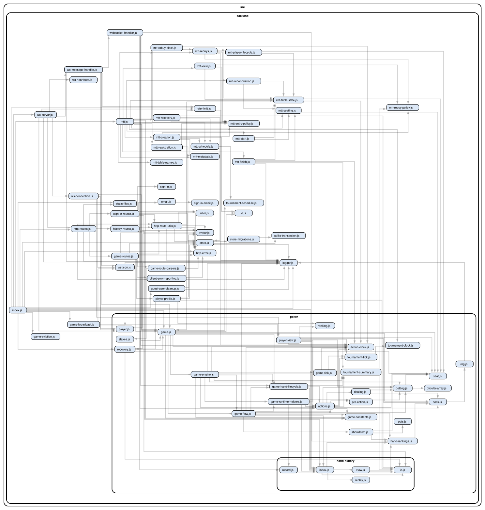

# Backend

One Node.js process serves the frontend, the JSON APIs and the WebSocket
connections, and runs every live game. `index.js` wires the pieces together and
owns the in-memory state: cached users, live games, open connections and the MTT
manager. Poker rules live in [`poker/`](poker/README.md). This directory covers
everything around them.

## Requests and connections

**HTTP** uses Node's `http` module with a small router. `http-routes.js`
composes the route modules (`*-routes.js`). It also serves the single-page app
and static files, with gzip and ETags. Frontend files and Lit are served
straight from the source tree and `node_modules`, so there is no build step.
Every route handler receives the request's canonical log (see
[Logging](#logging)) and adds its context to it.

**WebSocket** (`ws` package) connections attach to one game or one tournament
when they upgrade. Clients send JSON intents with an `action` field;
`ws-message-handler.js` validates and executes them. The server pushes:

- `gameState`: a view built separately for each player (see
  [player views](poker/README.md#player-views)). It is sent whenever the game
  changes, including on each clock tick while a timer runs.
- `tournamentState`: MTT standings, tables and clock.
- `social` (chat and emotes) and `history` (a hand was recorded).

The server sends the full view every time rather than diffs, which keeps
clients stateless: a client that reconnects simply receives the current view.
Diffs are a possible later optimization if traffic ever matters. A heartbeat
closes dead connections.

**Rate limiting.** HTTP requests and WebSocket actions share one budget per
session, falling back to the IP address. Creating guest accounts has its own
limit. Behind the proxy, client IPs come from `X-Forwarded-For`, trusted only
from `TRUSTED_PROXY_CIDRS`.

## Identity and sign-in

Anyone can play without an account. The first request creates a guest user,
which is persisted, and stores its ID in the `phg` cookie. Signing in uses
passwordless email links (`sign-in*.js`, sent through AWS SES by `email.js`).
Completing sign-in merges the guest into the registered account. Hand
histories, activity rows, live seats and open connections are all rewritten
to the registered ID, so nothing played as a guest is lost.

Sign-in tokens are short-lived and kept in memory. On a single instance this is
enough: a restart only invalidates links that have not been used yet. Old
guests that never played a hand are deleted periodically.

## Persistence

| Store                    | Holds                                                           | Why                                                                                 |
| ------------------------ | --------------------------------------------------------------- | ----------------------------------------------------------------------------------- |
| Memory                   | Live games, tournaments, connections, sign-in tokens            | Single process; the hot path never touches disk                                     |
| `data/poker.db` (SQLite) | Users (guests and registered), who played at which table or MTT | Accounts and indexed lookups for profiles and history                               |
| `data/<id>.ohh`          | Every hand at a table, appended as it finishes                  | Open format, append-only, one file per table. This is the system of record for play |
| `data/<id>.ots`          | Tournament summaries                                            | Open format for results                                                             |

`DATA_DIR` sets the directory; production mounts it from a dedicated EBS volume
(see [infrastructure](../../doc/infrastructure.md)).

SQLite runs in WAL mode through the built-in `node:sqlite`. Migrations in
`store-migrations.js` are append-only. Each one's position is recorded in
`PRAGMA user_version`, and they run in a single transaction at startup. The
expected schema is then validated, so an incompatible database stops the
server instead of corrupting data. There is no tournaments table: tournament
state lives in memory and in OTS files, and `tournament_id` in the activity
tables is only a grouping key.

**Recovery.** Games idle for an hour are evicted from memory
(`game-eviction.js`). When someone connects to a cash game, Sit & Go or bot
table that is not in memory, after an eviction or a restart,
`poker/recovery.js` rebuilds it from its hand history. Finished MTTs are rebuilt from their OTS summary for
viewing. A running MTT is not restored after a restart.

## Tournaments

A **Sit & Go** is a single game with tournament state, such as the blind clock
and finishing positions, attached to it.

A **multi-table tournament** is coordinated by the MTT manager (`mtt.js`). Each
table is an ordinary game of kind `mtt`. The manager handles registration,
seating, rebuys and the blind clock, and responds to the end of every hand. It
eliminates busted players, then breaks or rebalances tables. The `mtt-*.js`
modules each own one policy or lifecycle step, and `mtt.js` orchestrates them.
Blind structures adapt to the number of entrants and the chosen speed
(`tournament-schedule.js`, `src/shared/tournament.js`).

## Lessons

`/learn` lists two training modes. `/learn/preflop` is a preflop trainer
(`learn*.js`). The server deals a scenario and grades the submitted strategy
against reference charts in `learn-ranges.json`. The answer is revealed only
after the submission. Scenarios are stateless identifiers: no game, connection
or stored progress is involved. The pre-decision action sequence also comes from
the server as replay snapshots, so the browser never derives poker actions or
answers itself. The charts come from a book; see
[Preflop lessons](../../doc/learn.md) for their source, extraction and the
teaching decisions.

## Bot tables

"Play vs bots" (`bot-*.js`) gives a learner a private six-handed table against
five bots. It is an ordinary in-memory game of kind `bots`, so betting, pots
and showdown are the same code as everywhere else. What differs:

- **Recorded, but kept off profiles.** Hands are written to the table's OHH
  file like any other, so the table has rankings with BB/100 and a hand
  history. Only the learner gets an activity row, which sign-in merges like
  any other; bots are not users. Player profiles skip bot tables: practice
  against bots is not a result against people. An evicted or restarted bot
  table is rebuilt from its history when the learner opens its URL again;
  recovery recognizes it by the roster's bot ids, which are therefore
  permanent. The hand history cannot say how a bot chose, so each
  `bot_action` log line carries the engine request, the strategy it returned
  and the sampled draw. A request replayed through `noregrets serve` shows
  the same strategy again.
- **Private.** Only the seated learner may connect, nobody else can sit, and
  the learner cannot give up the seat. Leaving (`DELETE /api/learn/bots`) or
  opening a new table ends the live table, after recording the hand that just
  ended; its URL resumes it from its history.
- **Always 100 BB, always six, no clock.** Every stack is reset to 100 BB
  after each hand, because a blueprint is solved for one depth: short stacks
  measurably weakened the bots, and deep ones looked broken (a bot "shoved"
  100 BB and kept the rest behind). The reset counts as a top-up or a
  cash-out in the seat's buy-in, so the rankings still show the session's
  net result. The fork can serve extra blueprints for
  other depths (`serve --also`) if a short-stack mode is ever wanted. A hand is dealt only while all six seats play. With no
  action clock there is nothing to sit out from, so the learner cannot sit
  out; a disconnect still sits them out, which pauses the table until they
  sit back in.
- **Bots act on broadcasts.** Every state broadcast runs the bot driver. When
  a bot is to act, it asks the engine once for that decision, samples the
  returned mix with the game's RNG (so `RNG_SEED` keeps e2e runs
  reproducible) and applies the action through the same
  path as a WebSocket action. If the engine fails, the bot checks or folds.

The engine (`bot-engine.js`) is the `serve` command of our
[noregrets fork](https://github.com/eliOcs/noregrets), an MCCFR blueprint in
the style of Pluribus, run as one child process that answers JSON lines. A
child process needs no native build, and an engine crash cannot take the
server down; a separate service only pays off if the engine ever needs its
own machine. Each request describes the whole hand so far, built from the
hand-history recorder, so the engine keeps no table state and a crash loses
nothing; it restarts with growing delays. Until it reports ready, opening a
table answers 503. Bot identities and their avatars come from a fixed roster
(`bot-roster.js`).

The bots are good enough for recreational players, not unbeatable, and the UI
never calls them "GTO":

- **Blueprint only.** Real-time search was measured as more exploitable than
  the blueprint alone, against a probe that models the search.
- **Off-menu bet sizes** are mapped by the fork to the log-nearest size on the
  engine's bet menu. Arbitrary sizes cost the human, not the bots; betting
  just under a menu size wins about 0.05 BB per hand.
- **Preflop differs from the lessons.** The blueprint comes from another
  solver than the lesson charts, and it sometimes limps strong hands from
  early position.

Bot quality is improved inside the fork, behind the same protocol; its
`BASELINES.md` records the measurements.

## Avatars

Users store an avatar configuration in their settings. Broadcasts carry only a
content hash (`avatarRevision`), and clients fetch and cache the configuration
by revision. See [Avatars](../../doc/avatar.md).

## Logging

The server emits **canonical log lines**: one structured line at the end of
each unit of work, carrying all the context gathered along the way. A log is a
plain object made by `createLog(message)`. Code adds fields to `log.context`,
and `emitLog(log)` writes the line once, adding `durationMs`. One line per
unit makes filtering by table, player or hand trivial.

| Message          | One per           |
| ---------------- | ----------------- |
| `http_request`   | HTTP request      |
| `ws_action`      | WebSocket message |
| `timer_action`   | game tick         |
| `hand`           | poker hand        |
| `bot_action`     | bot decision      |
| `eviction_sweep` | eviction run      |

The hand log lives on `game.handLog` and spans many messages and ticks. One-off
events (connect, shutdown, recovery warnings) use plain `logger.info` or
`logger.warn`. Set `LOG_FORMAT=json` for structured output, as in production.
