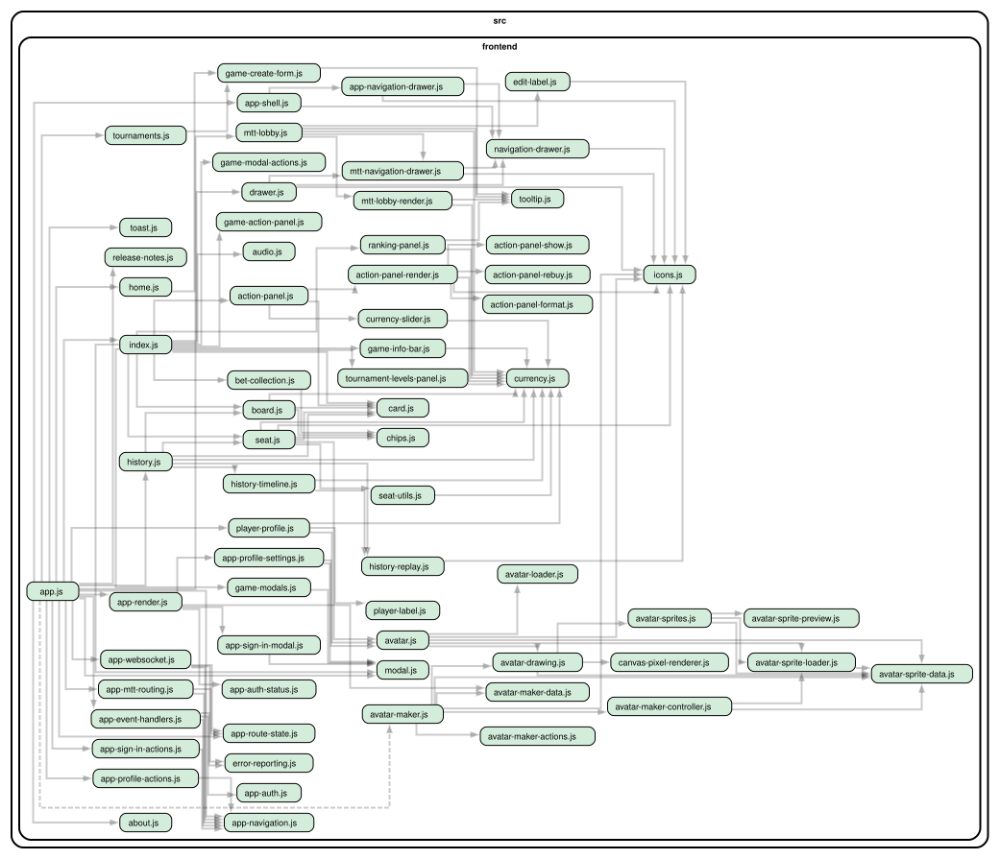

# Frontend

A single-page app of [Lit](https://lit.dev/) web components. It renders the
state the server sends and turns user input into intents. Poker rules never
run here (see [backend authority](../../README.md#principles)). Frontend code
covers presentation: layout, animation, formatting and input controls.

## No build step

The browser loads these files as they are. `index.html` declares an import map
that resolves `lit` to files the backend serves from `node_modules`. Modules in
`src/shared` are served at `/src/shared`. Changes need only a reload: there is
no bundler, transpiler or dev server to configure, and stack traces point at
real source lines. Modern browsers handle ES modules, import maps and HTTP
compression well enough that bundling would buy little here.

## Light DOM

Components render into the light DOM (`createRenderRoot() { return this; }`)
and are styled by ordinary global stylesheets. `app.css` imports
`base.css` (design tokens and resets) and one file per area in `styles/`.
Shadow DOM was used originally and removed. Its isolation protects
independently distributed components, which this app does not have, and it
cost a lot: shared CSS had to be imported into every component, parents could
not style children, native form association broke across boundaries, events
needed `composed: true`, and tests had to walk `shadowRoot`s. With one DOM
tree, CSS, forms, focus and tests behave like plain HTML.

Lit still provides reactive properties, declarative templates and lifecycle
hooks. Components follow "properties down, events up": parents pass data
through properties, and children dispatch DOM events.

Short text in centered controls goes in ``. The
pixel font (Press Start 2P) sits off-center vertically, and this one shared
rule corrects it. That avoids per-component nudges.

## Application shell and state

`<phg-app>` (`app.js`, with `app-*.js` helpers) owns the application state:
the current route, the signed-in user, the WebSocket connection and the latest
game or tournament view. Pages and the table receive that state as
properties.

- **Routing.** `app-route-state.js` maps paths to pages using the route
  matchers shared with the backend (`src/shared/routes.js`).
  `app-navigation.js` uses the Navigation API where it is available and falls
  back to the History API.
- **App-level modals** (settings, sign-in, sign-up) live in the URL as
  `?modal=…`. The Back button closes them naturally, and the avatar editor can
  return to the settings draft it came from.
- **WebSocket.** There is one connection per page, opened for the current game
  or tournament. Each game action carries an ID that the server acknowledges.
  If the acknowledgement is missing or does not match, the app reconnects to
  resync rather than guessing at state.
- **Errors** in the browser are reported to the backend
  (`error-reporting.js`), which logs them.

## Table layout

`table-layout.js` is shared by live games and hand-history replays. The table
is drawn on a fixed logical surface (portrait or landscape), and one scale
factor fits that surface into whatever space remains after the navigation and
controls. Fixed logical coordinates make the layout predictable at any size.
The seat positions for 2, 6 and 9 players are explicit CSS Grid placements
(`styles/table-layout.css`), not computed geometry, with a separate region
reserved for the board. The design came out of a
[layout study](../../doc/table-layout-study.md).

- `data-seat` is the server's seat index. Actions always use it.
  `data-slot` is the visual position, rotated so the local player sits at the
  bottom.
- The action panel reserves a fixed height. Waiting, acting and reconnecting
  never resize the table, so cards and buttons do not shift under the player's
  finger.

## Avatars

`<phg-avatar>` draws avatars on a canvas from a configuration and sprite
layers. The avatar maker lives on its own `/avatar` page. See
[Avatars](../../doc/avatar.md).

## Tests

Component tests are in [`test/frontend`](../../test/frontend). Visual states
are covered by the [UI catalog](../../test/ui-catalog/README.md). See
[test/README.md](../../test/README.md) for which layer to use.
